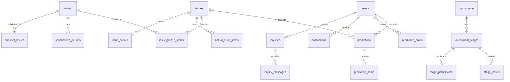

# 論理設計・検証項目

## データの関係（概略）

初期SQL定義は `../migrations/001_initial.sql` を参照。ほぼすべてのテーブルで固定IDを使い、`username` の変更が過去成績と紐付けを壊さないようにする。

## 今回実装済みの不変条件

1. `issues`: 同一年の同じ号番号を共有する通常号・合併号の共存禁止（INSERT/UPDATEトリガー）。
2. `issues`: `status='open'` は一件まで（部分UNIQUEインデックス）。
3. `works`: 4桁IDと種別。
4. `serialization_periods`, `oneshot_issues`: 未登録の将来号コードを保持できる（わざと `issues` の外部キーを付けていない）。
5. `issue_frozen_works`: 受付開始時に保存する予想対象作品・カラー・初期順序。
6. `predictions` と `prediction_drafts`: 別テーブル。正式提出の初回日時は再提出で変えない（更新ロジックで保証予定）。
7. `issue_sudden_hiatus`: 凍結済み作品だけを突発休載として登録できる。
8. `tournament_stages`: 大会につき予選と本戦はそれぞれ最大一段階。
9. `announcements`, `notifications`: 重要固定お知らせの一回限りの通知を設計可能（DBだけでなくAPI側のトランザクションも必要）。
10. `users`: 初期創設者ロールの降格・削除禁止。

## APIサービスを実装する際の必須検証

- **受付開始**: 有効な発売日・締め切り、対象作品、カラー指定、事前休載の確認、通常号／合併号と作品期間の整合性、他に受付中の号がないことをサーバー側で確認。作品一覧・色・初期順を一度の処理で凍結する。受付開始後の自動再選定は禁止。
- **号の編集**: 作品の期間変更は `planned` 号へ自動反映。手動で追加・除外した作品やカラー・事前休載の設定を尊重する。
- **正式提出**: 受付中・締切前・全対象作品の重複なし完全順位を検証。保存中に締切到達しても受理されないよう、DB操作時に再確認。初回提出日時は保持。
- **過去代理提出**: 管理者権限必須。対象号とユーザーを確認した後に上書き、公開済みスコア／大会累積や失格を一貫して再算出する。
- **実掲載順・採点**: 予定外作品が実誌面に存在しても実順位に保存可能。計算時は凍結作品から突発休載を除いた集合だけを残し、予想・実績を個別に詰める。下書き保存と正式採点確定を区別する。
- **成績公開**: 採点確定 && *次の登録済み号の発売日*00:00 JST経過。次号が後登録の場合は条件成立時に即公開。公開済みは再び非公開にしない。一般利用者には未公開の集計を返さない。
- **大会**: 対象号の重複禁止、前号による大会公開、予選申込期限、本戦候補の下書きと発表の区別、失格判定、指定号までの累積順位の再計算がAPI実装事項。
- **認証**: パスワードおよび質問回答はソルト付き耐推測ハッシュ、2問は別の質問、一定期間の試行制限、HttpOnly+Secure+SameSite セッション、パスワード変更時に全セッション失効。認可はすべてVercel側で実施。秘密はブラウザやGitHubに持たせない。
- **変更の整合性**: 再採点は影響のある号のランキングと大会集計を原子的または読み出し時一貫して再計算。大会の順位は号別得点を基にする。

## 初期スキーマに対する明確な留保

- `serialization_periods` の重複期間や `kind` と連載／読み切り子表の一致は、追加の検証実装が必要。
- 号コードの年についてDBは数字4桁を検証し、UIの選択は2021年以降（将来年も可）にする。過去号の合法な例外は後続の移行で判断する。
- 各号のカラーと事前休載の完全な入力確認状態は、`plan_reviewed_at` と `src/core/readiness.ts` の検証で実装する。`plan_reviewed_at` の値を管理者入力・作品変更時に適切に無効化する。
- `actual_order_draft_items` は途中保存用。採点確定前に正式 `actual_order_items` の完全性をチェックする。
- 将来号を取り扱える `stage_issues` では、ユーザーからの任意SQLを許さず正規化した号コードを受け付ける。
- PDFはブラウザで生成する第一候補で、iPhoneへの保存と日本語描画を必ず検証する。
- Tursoの無償枠・API・ドライバー仕様は変更されうる。本番接続時に公式ドキュメントを再確認する。
